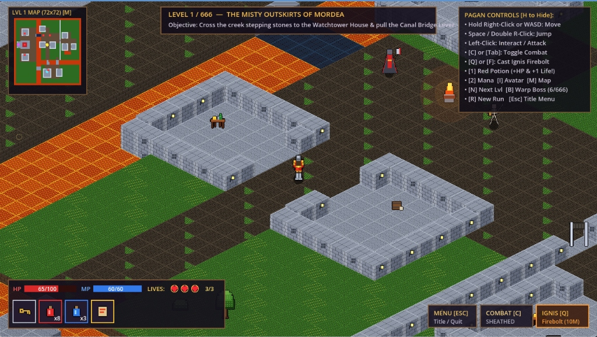

# Ultima VIII: Pagan (Inspired) — The 666 Procedural Realms (Godot 4.7)

An isometric dark-fantasy action-adventure game built for **Godot 4.7**, paying homage to Origin Systems' ***Ultima VIII: Pagan*** (1994), featuring **666 procedurally generated `72x72` outdoor realms**, cut-away Tenebrae stone houses, cobblestone streets, a 3-Lives & potion-restoration system, and Boss battles at **Level 6** & **Level 666**.

## How to Run
1. Open **Godot Engine 4.7**.
2. Click **Import** and select `project.godot`.
3. Press **F5** (or click the **Play** button) to play!

*(All visuals, isometric 3D-height blocks, character animations, dynamic lighting, and 16-bit SoundBlaster-style sound effects & dark organ drone are procedurally generated in GDScript—no external asset imports required.)*

---

## Controls (Classic Ultima VIII + Modern Hybrid)

| Action | Classic Pagan Mouse | Keyboard / Hybrid |
| :--- | :--- | :--- |
| **Walk / Run** | Hold **Right Mouse Button** (cursor distance controls walk vs. run speed) | **WASD** or **Arrow Keys** |
| **Jump** | **Double Right-Click** or **Middle-Click** toward cursor | **Spacebar** |
| **Interact / Loot / Use** | **Left-Click** on nearby object | **E** |
| **Examine Object** | **Left-Click** on distant object | — |
| **Toggle Combat Mode** | Click **COMBAT** Gump button | **C** or **Tab** |
| **Melee Attack** | **Left-Click** enemy (or anywhere while in Combat Mode) | — |
| **Cast Ignis Firebolt** | Click **IGNIS** Gump button (requires *Ignis Scroll*) | **Q** or **F** |
| **Drink Potions** | Click potion in Satchel Gump | **1** (Red Heal: `+50 HP` & `+1 Life`) / **2** (Blue Mana) |
| **Avatar Paperdoll Gump** | — | **I** or **P** |
| **Sanctum Minimap Gump** | — | **M** |
| **Procedural Level Warp** | — | **N** / **PgDn** (Next Level) • **B** (Warp to Boss Level 6 / 666) |
| **Toggle Help / New Run** | — | **H** (Help) / **R** (Restart New Procedural Run) |
| **Start Screen / Credits / Quit** | Click **Start Game**, **Credits**, or **Quit Game** | **Esc** (Open Menu) / **W,S** + **Enter** |

---

## Core Gameplay Systems: 666 Procedural Levels, Bosses & 3 Lives

- **666 Procedurally Generated Sanctums (`LevelData.build_level()`)**:
  - Every level from **Level 1 to Level 666** is procedurally generated with randomized East/West mirroring, room geometry, lava/water fissures, stepping-stone elevations, crumbling bridges, loot caches, and enemy patrols.
  - Awakening and entering the **Blackrock Obelisk** warps the Avatar to the next procedural Sanctum while preserving your weapons, spells, potions, and remaining lives.
- **Boss Battles at Level 6 & Level 666 (and every 6th Sanctum)**:
  - **Level 6 (*The Crimson Throne of Malchir*)** and **Level 666 (*The 666th Abyssal Throne of Pagan*)** generate a molten-lava **Boss Citadel** where you face **Malchir / Pyros, Arch-Executioner of Pagan** (`titan_boss`), complete with a top-screen Boss Health Bar and multi-bolt sorcery barrages.
  - Vanquishing the Boss on **Level 6** awakens the Grand Blackrock Obelisk to complete the trial (with the option to continue descending all the way to **Level 666**!).
- **3 Lives System & Potion Life Restoration**:
  - You begin each run with **3 Lives (`♥ ♥ ♥ 3/3`)** displayed in the Status Gump alongside HP and MP.
  - Taking lethal damage (`0 HP`) or falling into water/lava costs **1 Life** (`lives -= 1`).
  - Quaffing a **Red Healing Potion** (`[1]` or clicking it in the Satchel) restores **`+50 HP` AND `+1 Life`** (up to `3/3 Lives`), even if your HP is already full!
  - **Permadeath Procedural Reseed**: Losing all **3 Lives** (`0/3`) ends the run and automatically restarts the game at **Level 1** on a **brand-new procedurally generated realm**!

---

## Assets (`res://assets/`)
- **`res://assets/music/`**:
  - `pagan_ost.ogg` / `pagan_ost.mp3` — Authentic *Ultima VIII: Pagan — Main Theme* (plays on the **Start Screen**).
  - `tenebrae.ogg` / `tenebrae.mp3` / `tenebrae.wav` — Authentic *Ultima VIII: Pagan — Tenebrae Theme* (plays during level exploration).
  - `docks.ogg` / `docks.mp3` — Authentic *Ultima VIII: Pagan — Carthax Lake / Docks Theme*.
  - `combat.ogg` / `combat.mp3` / `combat.wav` — Authentic *Ultima VIII: Pagan — Combat Theme* (activates automatically when toggling Combat Mode `[C]`).
  - `midi/` — Original *Ultima VIII: Pagan* reference MIDI files (`tenebrae.mid`, `theme.mid`, `docks.mid`, `combat.mid`, `execution_scene.mid`, `catacombs.mid`).
- **`res://assets/sprites/`**:
  - Pixel-art sprites (`avatar.png`, `avatar_combat.png`, `skeleton.png`, `executioner.png`, `brazier.png`, `obelisk.png`, `tile_obsidian.png`) are automatically exported to `res://assets/sprites/` on startup by `SpriteFactory.export_sprites_to_assets()`.

---

## Mini-Level Walkthrough: *The Sunken Sanctum*

1. **The Docks of Tenebrae**:
   - Search the **Slain Tormented Guard** on the dock to obtain the **Rusty Iron Key**, and loot the **Ironbound Chest** for Healing & Mana potions.
   - Unlock the **Iron Portcullis** to enter the lower courtyard and defeat the **Restless Skeleton**.
2. **The Stepping Stones of Hydros & Pyros**:
   - Jump across the elevated basalt pillars over the Lurker's dark water and crumbling stone ledges to reach the eastern **Watchtower Bastion**.
   - Defeat the **Pyros Bone Sentinel**, open the **Coffer of the Flame** to claim the **Flame Sting Blade** and **Ignis Spell Scroll** (`Kal Vas Flam`), and pull the **Ancient Floor Lever** to raise the **Sunken Obsidian Bridge**.
3. **The Sanctum of the Crimson Pentagram**:
   - Cross the raised bridge into the northern Sanctum and battle **Mordea's Executioner Wraith** (or open the **Necromancer's Sarcophagus**) to recover a **Blood Ritual Candle**.
   - Ignite all **3 Ritual Pyres** around the Pentagram (by left-clicking them or blasting them with **Ignis Firebolt**) and place the **Blood Ritual Candle** at the **Heart of the Pentagram**.
   - Step up to the awakened **Blackrock Obelisk** on the north dais and activate it to escape Pagan!
